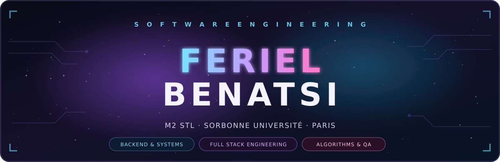
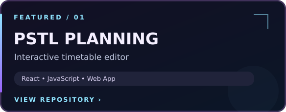
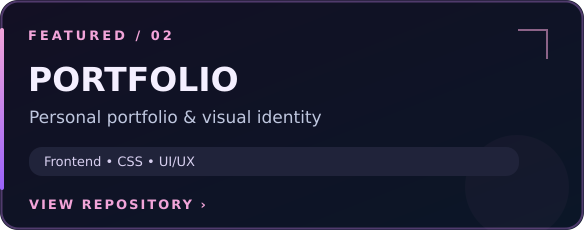
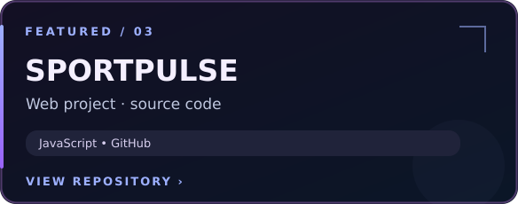
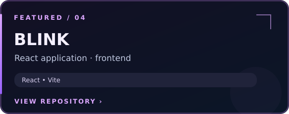

<!-- Profil GitHub de Feriel Benatsi. Design original, thème neon/cyber.
     Pour afficher ce README sur le profil, créer un dépôt PUBLIC FerielBenatsi
     et placer ce fichier README.md à sa racine, avec le dossier assets/. -->

 

**Software Engineer in the making · Backend · Full Stack · Algorithms**

*I enjoy turning complex problems into clear, reliable and maintainable software.*

## <code>01 / ABOUT_ME</code>

🎓 Étudiante en **Master 2 Informatique — Science et Technologie du Logiciel** à **Sorbonne Université**.

💻 Intéressée par le **développement backend et full stack**, l'**algorithmique**, la **qualité logicielle** et la **conception de systèmes fiables**.

⚙️ J'aime comprendre ce qui se passe derrière une application : architecture, données, concurrence, tests et automatisation.

🌱 J'approfondis actuellement mes compétences en **Java / Spring Boot**, **API REST**, **CI/CD** et **cloud**.

## <code>02 / TECH_STACK</code>

**LANGUAGES**

    

**WEB & BACKEND**

    

**TOOLS & DATA**

    

## <code>03 / FEATURED_PROJECTS</code>

<table align="center">
<tr>
<td width="50%"></td>
<td width="50%"></td>
</tr>
<tr>
<td width="50%"></td>
<td width="50%"></td>
</tr>
</table>

[**EXPLORE ALL REPOSITORIES →**](https://github.com/FerielBenatsi?tab=repositories)

## <code>04 / GITHUB_ANALYTICS</code>

<!-- Ces cartes sont chargées par un service tiers ; elles peuvent être indisponibles ponctuellement. -->

## <code>05 / ACTIVITY_PULSE</code>

Les statistiques sont automatiquement générées à partir de l'activité publique GitHub. Les services tiers peuvent parfois ne pas répondre.

